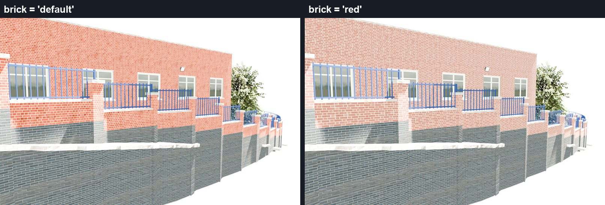
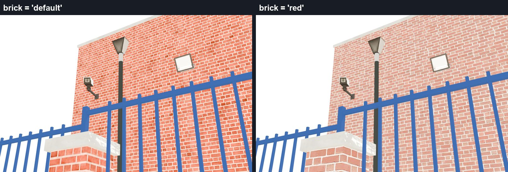
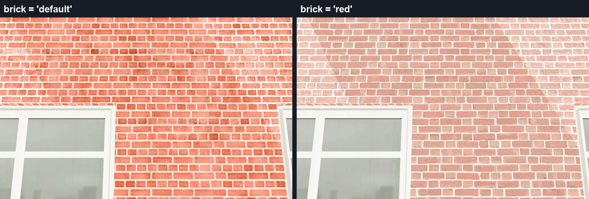

# Options - Mission Plaza UK Police Station

Optional looks for the station. Each one is a single line in `config.lua`; nothing to download, copy or rename.

## Classic red brick exterior

GTA's own classic red brick - the Flemish bond of the Davis sheriff station - laid at real UK brick size on the whole
exterior: the building walls, the boundary walls and piers, the roof enclosure and the distance models, so everything
matches. The grey brick base, the copings, the windows and the doors stay as they are.

### Switch it on

1. Open `config.lua` in the `nobs_ukpd_missionplaza` folder and find section 5, EXTERIOR BRICK.
2. Change `MPExterior = { brick = 'default' }` to `MPExterior = { brick = 'red' }`.
3. Restart the resource (or the server). Every player sees the red brick.

To switch back, set `brick = 'default'` and restart the resource.

### Good to know

- The station's own script swaps the brick textures while the resource runs; the models, collision, doors and other
  resources are not touched. Stopping the resource puts the original textures back.
- Any value other than `'default'` or `'red'` prints one yellow line in F8 and keeps the default brick.
- Every update replaces `config.lua`: set the option again after updating (`install/docs/INSTALL.md`, "Updating").
